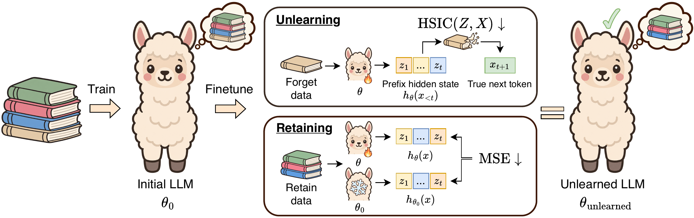

<div align="center">

# Forget What Comes Next
### LLM Unlearning via Statistical Independence



</div>

**PINT** unlearns by making the model's hidden states independent of the tokens they predict on the forget set, while keeping retain-set representations close to the original model:

```math
\mathcal L_{\mathrm{PINT}}(\theta)
=\lambda\,\widehat{\mathrm{HSIC}}(\mathbf Z_f,\mathbf X_f)
+\big\lVert \mathbf Z_r^{\theta}-\mathbf Z_r^{\theta_0}\big\rVert^2
```

Here $`\mathbf Z_f`$ and $`\mathbf X_f`$ are the hidden states and next tokens on the forget set, $`\mathbf Z_r^{\theta}`$ and $`\mathbf Z_r^{\theta_0}`$ are the retain-set hidden states of the current and original model, and $`\lambda`$ sets the forgetting strength.

We implement PINT (`src/trainer/unlearn/pint.py`) in the [OpenUnlearning](https://github.com/locuslab/open-unlearning) framework, so PINT and all baselines share the same data, training and evaluation pipeline on every benchmark.

---

## Setup

```bash
uv sync
source .venv/bin/activate
python setup_data.py --eval_logs --wmdp
```

The WMDP-Bio forget corpus requires [requesting access](https://huggingface.co/datasets/cais/wmdp-bio-forget-corpus). Save it as `data/wmdp/wmdp-corpora/bio-forget-corpus.jsonl`.

## Running experiments

One command trains a model and evaluates it:

```bash
bash scripts/unlearn.sh <benchmark> <method> [hydra overrides...]
```

| Benchmark | `<benchmark>` | Model | GPUs | Setting |
|---|---|---|:-:|---|
| [TOFU](https://locuslab.github.io/tofu/) | `tofu` | Llama-3.2-1B-Instruct | 1 | `forget_split=forget01 \| forget05 \| forget10` |
| [MUSE](https://muse-bench.github.io/) | `muse` | Llama-2-7B / ICLM-7B | 2 | `data_split=News \| Books` |
| [WMDP](https://www.wmdp.ai/) | `wmdp` | Zephyr-7B | 2 | `data_split=cyber \| bio` |
| bioS | `bios` | Llama-3.2-1B-Instruct | 1 | `bios_seed=0` |
| [Gaussian poisons](https://huggingface.co/collections/sbordt/martin) | `olmo_gw` | OLMo-2 2.7B | 4 | – |

`<method>` is one of `pint`, `gradascent`, `graddiff`, `npo`, `simnpo`, `undial`, `rmu`. Each preset is in `configs/experiment/unlearn/<benchmark>/<method>.yaml`, and hyperparameters are set with Hydra overrides. [`docs/settings.md`](docs/settings.md) lists a setting near the forgetting target for every method and benchmark, e.g.

```bash
bash scripts/unlearn.sh tofu pint forget_split=forget10 trainer.method_args.lambda=380 trainer.args.learning_rate=2e-5
bash scripts/unlearn.sh muse pint data_split=Books trainer.method_args.lambda=20 trainer.args.learning_rate=2e-5
bash scripts/unlearn.sh wmdp pint data_split=bio trainer.method_args.lambda=30000 trainer.args.learning_rate=5e-5
bash scripts/unlearn.sh olmo_gw pint trainer.method_args.lambda=100 trainer.args.learning_rate=3e-5
bash scripts/unlearn.sh tofu rmu forget_split=forget10 trainer.method_args.steering_coeff=5 trainer.args.learning_rate=7.5e-6
```

**bioS** first fine-tunes the model on the generated biographies:

```bash
python src/train.py --config-name=train.yaml experiment=finetune/bios/default bios_seed=0
bash scripts/unlearn.sh bios pint bios_seed=0
bash scripts/unlearn.sh bios rmu bios_seed=0
```

**Llama-3-70B** (WMDP-Cyber, 4 GPUs):

```bash
bash scripts/unlearn.sh wmdp pint_70b trainer.args.seed=1
```

Results are written to `saves/unlearn/<name>/evals/*_SUMMARY.json` (for the Gaussian poisons, one per checkpoint). Environment variables: `NAME` (run name), `NGPU`, `EVAL=0` (train only).

## What is added to OpenUnlearning

```
src/trainer/unlearn/pint.py         PINT trainer
src/data/bios.py, src/evals/*bios*  bioS benchmark (data, metric, evaluator)
src/data/gw.py,   src/evals/*gw*    Gaussian-poison benchmark (data, metric, evaluator)
configs/experiment/unlearn/         presets for every benchmark and method
scripts/unlearn.sh                  train + evaluate
```

The framework is documented in the [OpenUnlearning docs](https://github.com/locuslab/open-unlearning/tree/main/docs).

## Acknowledgements

We thank the authors of [OpenUnlearning](https://github.com/locuslab/open-unlearning), whose framework this code builds on and which is released under the MIT license. We also thank the authors of [PhysicsLM4](https://github.com/facebookresearch/PhysicsLM4), the source of the name lists in our bioS benchmark (Apache 2.0, see [`src/data/bios_fields/NOTICE`](src/data/bios_fields/NOTICE)), and the authors of the Gaussian-poison models and data for making them publicly available on the Hugging Face Hub.

## License

MIT, see [`LICENSE`](LICENSE).

## Citation

```bibtex
@misc{shkabrii2026forgetcomesnextllm,
      title={Forget What Comes Next: LLM Unlearning via Statistical Independence}, 
      author={Andrii Shkabrii and Claudia Plant and Martin Pawelczyk},
      year={2026},
      eprint={2611.03955},
      archivePrefix={arXiv},
      primaryClass={cs.LG},
      url={https://arxiv.org/abs/2611.03955}, 
}
```
